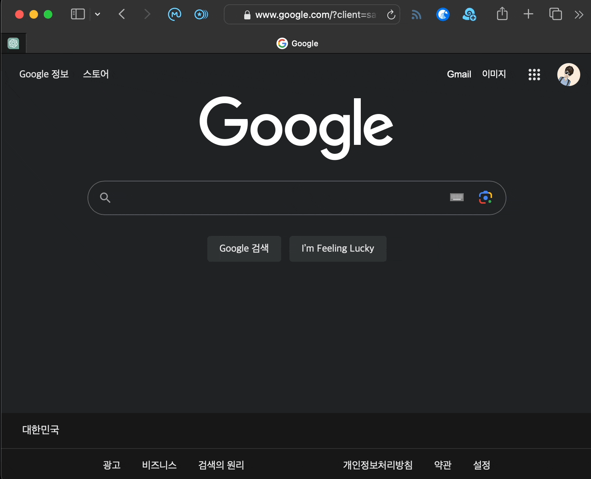
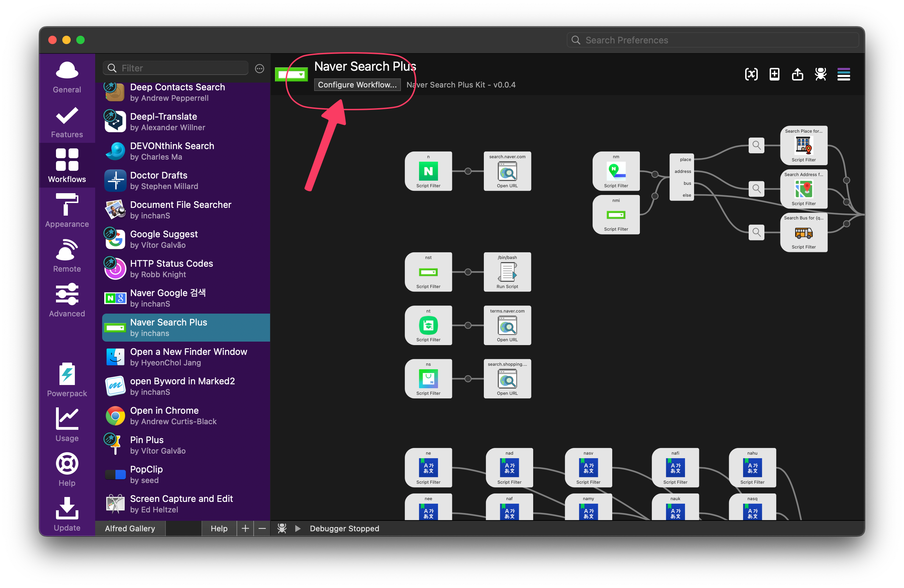
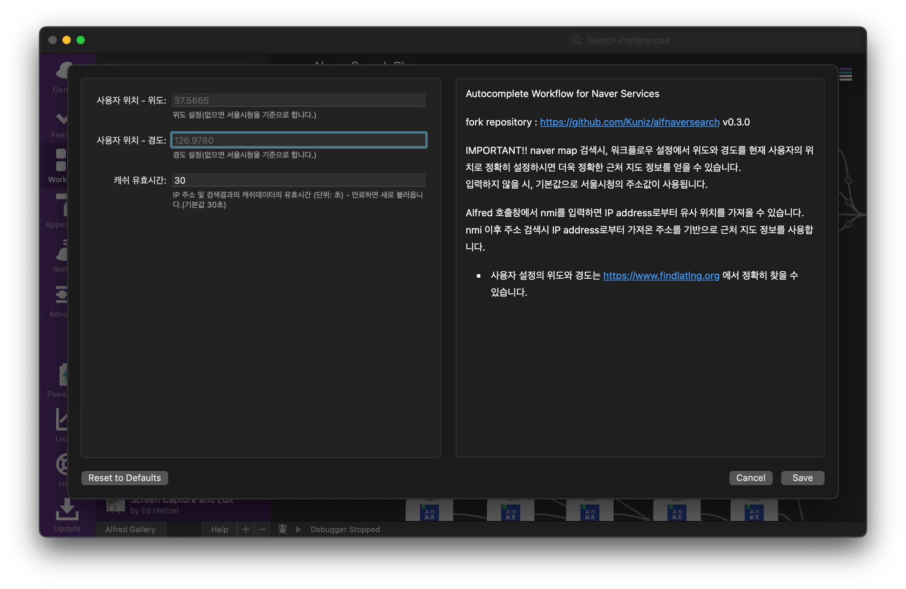

# AlfNaverSearchPlus : Naver Search Workflow for Alfred  
   

   

> **Alfred 4·5 사용자는 이전 메이저 버전인 2.x를 사용해 주세요.**  
> **3.x는 Alfred 6에서만 동작합니다.**  
> 2.x 패키지는 [이전 릴리스](../../releases)에서 다운로드할 수 있습니다.

Naver Search Workflow for Alfred
---------------------------------

[Alfred](https://www.alfredapp.com/)에서 네이버 검색, 네이버 쇼핑, 네이버 지식백과, 네이버 지도, 네이버 증권    
그리고 각종 네이버 사전 검색이 자동완성 되는 워크플로우
<br>  
<br>  

### **Acknowledgments**
[@Kuniz](https://github.com/Kuniz)님의 [alfnaversearch 워크플로우](https://github.com/Kuniz/alfnaversearch)를 따로이 개인적인 용도에 맞게 부분적으로 수정 및 개선한 워크플로우입니다.  
**alfnaversearch** 워크플로우의 코드기여는 [forked repository](https://github.com/inchanS/alfnaversearch)에서 진행하였습니다.    

#### **변경부분**
1. 네이버 **지도 검색 기능 추가 및 개선** (updated v0.0.2)
    - 사용자 위치 설정 및 장소, 주소, 버스 전용보기 추가 
2. 네이버 **증권(주식) 검색 추가** (updated v0.0.4)
3. **워크플로우 자동 업데이트 기능 추가** (updated v0.3.1)
4. **Go 단일 바이너리로 전면 재작성** (updated v2.0.0)
    - **`v1.x.x`까지는 워크플로우 사용을 위해 Python 3이 필요했지만, `v2.0.0`부터는 Python이 필요 없습니다.**
      - Python 및 alfred-pyworkflow 의존을 완전히 제거하여 별도 런타임 설치가 불필요
    - Apple Silicon / Intel 유니버설 바이너리, 검색 기동 속도 대폭 향상 (아래 [Performance](#performance) 참고)
5. `nn` 명령어로 [네이버 통합검색](#통합검색-alfred-6) 기능(일반, 지도, 주식, 쇼핑) - Alfred 6버전 필요! (updated v3.1.0)
    - 통합검색시 언어 입력소스 설정 가능(updated v3.2.0)


<br>  


Preview
--------
**네이버 검색, 쇼핑, 지식백과, 증권 등**  


<br>  

**네이버 지도 검색**



<br>  

Configure Workflow...에서 사용자의 위치를 정확하게 입력후 `nm...`를 사용하시면,  
**IP 위치 기반(`nmi...`)보다 훨씬 더 자세한 근처 정보를** 얻을 수 있습니다!!   

<br>  

Install workflow
--------------

- [releases](../../releases/latest) 페이지의 `NaverSearchPlus.alfredworkflow`를 다운로드 받아서 실행한다.

- **`v2.0.0`부터 별도의 런타임 설치가 필요 없습니다.** (Python 불필요)
  - 워크플로우에 포함된 유니버설 바이너리(Apple Silicon / Intel)로 동작합니다.
  - 다운로드 격리(Gatekeeper)는 워크플로우 내부의 `run` 스크립트가 최초 실행 및 바이너리 교체 시 자동으로 해제합니다. 준비가 끝난 바이너리는 반복 작업 없이 실행합니다.
  - 참고: `v1.x.x` 이하 버전은 Python 3 설치가 필요했습니다. (`brew install python`, `xcode-select --install`)

- **3.x: Alfred 6 + Powerpack 필요**
- **2.x: Alfred 4·5 사용자용 이전 메이저 버전**

Auto Update
--------------

v0.3.1부터 자동 업데이트를 지원합니다.

> **Alfred 4·5 사용자는 3.x 업데이트를 설치하지 마세요.** 기존 2.x 업데이터는 Alfred 버전을 판별하지 않으므로 3.x 업데이트도 안내할 수 있습니다. 2.x를 계속 사용하고, 실수로 업데이트했다면 [이전 릴리스](../../releases)에서 2.x를 다시 설치해 주세요. 이 경고는 자동 업데이트를 기술적으로 차단하는 기능은 아닙니다.

- 워크플로우 사용 시 **주 1회** 백그라운드에서 새 릴리스를 확인하며, 검색 속도에는 영향이 없습니다.
- 새 버전이 있으면 검색 결과 맨 위에 `New version of NaverSearchPlus is available!` 항목이 표시되고,
  선택하면 새 버전을 내려받아 설치합니다.
- 수동 명령어: 검색 keyword 뒤에 `workflow:update`를 입력하면 즉시 최신 버전을 내려받아 설치합니다. (예: `n workflow:update`)
- 자동 업데이트의 기능은 다음과 같이 켜고 끌 수 있습니다.
  - 자동 업데이트 끄기 : `n workflow:noautoupdate`
  - 자동 업데이트 켜기 : `n workflow:autoupdate`


Performance
--------------

`v2.0.0`에서 Python 기반 구현을 Go 단일 바이너리로 전면 재작성했습니다.

Alfred의 Script Filter는 **키 입력 한 번마다 프로세스를 새로 실행**하므로, 매 실행의 콜드 스타트 시간이 체감 반응 속도를 좌우합니다. 동일 머신에서 20회씩 측정한 결과는 다음과 같습니다.

| 구현 | 콜드 스타트(평균) | 비고 |
|---|---|---|
| **Go (`v2.0.0`, 전체 실행)** | **약 8 ms** | 프로세스 생성 + 실행 + JSON 출력 전체 |
| Python 인터프리터 기동만 | 약 29 ms | 스크립트·라이브러리 로드 이전 단계 |
| Python + 표준 라이브러리 로드 근사 | 약 70 ms | 기존 구현이 로드하던 비용의 하한선 |

- Go 버전의 **전체 실행(~8ms)** 이 Python 인터프리터가 시작만 하는 시간(~29ms)보다도 **약 3.6배 빠릅니다.**
- 실제 `v1.x.x`는 여기에 `alfred-pyworkflow` 라이브러리 로드까지 더해져 키 입력당 체감 지연이 더 컸으며, Go 전환으로 **타이핑 시 결과가 나타나는 지연이 눈에 띄게 감소**했습니다.
- 그 외 이점: python3 런타임 의존 제거(Command Line Tools 없이도 동작), Apple Silicon / Intel 유니버설 지원.

> 측정값은 실행 환경에 따라 달라질 수 있는 참고치입니다.

실행 스크립트 개선 전후를 같은 머신에서 각 60회 교차 측정한 결과입니다. 캐시가 적중하고 바이너리 준비가 끝난 상태에서, 매회 새 프로세스를 실행했습니다. 네이버 통신과 Alfred UI·큐 대기 시간은 제외했습니다.

| 측정 경로 | 개선 전 평균 | 개선 후 평균 |
|---|---:|---:|
| Script Filter와 같은 셸 실행 경로 | 17.51 ms | 10.45 ms |
| Go 바이너리 직접 실행 | 6.40 ms | 6.55 ms |

- 셸 실행 경로의 평균 시간이 약 40% 감소했습니다. 실행 권한·격리 해제는 최초 실행이나 바이너리 변경 시 처리하고, 반복 실행에서는 준비 작업을 생략합니다.
- 지도 전체 검색과 카테고리 전환은 위치 모드·좌표·검색어가 같고 캐시가 유효하면 API 응답 하나를 공유합니다.


통합검색 (Alfred 6)
--------------


`nn`을 입력하고 Enter를 누르면 Alfred 창 안에서 일반 검색이 열립니다. `nn 서울`처럼 검색어를 붙여 시작할 수도 있습니다. 검색어를 바꾸면 현재 카테고리만 조회하고, 새 제안이 도착하면 같은 목록에서 내용을 갱신합니다.

| 키 | 동작 |
|---|---|
| ⌃1 · ⌃2 · ⌃3 · ⌃4 | 일반 · 지도 · 증권 · 쇼핑으로 전환하고 같은 검색어로 다시 조회 |
| ⌘1–9 | 검색창이나 결과 목록에서 위에서부터 해당 순번의 결과 바로 열기 |
| ↑ · ↓ | 검색창에 그대로 머물면서 이전 · 다음 결과를 선택하고 검색어에 반영 |
| ⌘↓ | 결과 목록으로 포커스 이동 |
| ↩ | 선택한 결과 열기. 쇼핑에서는 네이버 가격비교 열기 |
| 쇼핑에서 ⇧↩ | 선택한 검색어를 네이버플러스 스토어에서 열기 |
| ⌘L | 검색창으로 돌아가기 |

**마지막 검색 이어가기**는 Configure에서 켤 수 있습니다(기본값 꺼짐). 켜면 `nn`을 다시 열 때 마지막 검색어와 탭을 복원합니다. 새 목록에 이전 항목이 있으면 다시 선택하므로 ↓로 다음 결과를 볼 수 있습니다. `nn 새 검색어`로 실행하면 일반 탭에서 새 검색을 시작합니다.

**통합검색 화면 설정**은 Alfred의 워크플로우 **Configure**에서 변경할 수 있습니다. 설정을 저장하고 `nn`을 다시 열면 적용됩니다.

| 설정 | 선택 항목 | 기본값 |
|---|---|---|
| 창 너비 | Alfred 테마에 맞춤 · 현재 너비(595) · 넓게(760) | 현재 너비 |
| 글자 크기 | 기본 · 크게 · 아주 크게 | 기본 |
| 표시할 결과 수 | 6개 · 8개 · 10개 | 6개 |

글자 크기와 표시할 결과 수에 맞춰 행과 창의 높이가 함께 바뀝니다. 선택한 개수보다 결과가 많으면 ↓ 키로 계속 탐색할 수 있습니다.

**통합검색 입력기 설정** — Alfred에서 `nnime`를 입력하고, 이 Mac에 활성화된 입력 소스 중 원하는 자판을 선택한 뒤 Enter를 누르세요. 다음에 `nn`을 열면 검색창에 한 번 적용됩니다. 두벌식·세벌식 등은 macOS에 등록된 각각의 이름으로 표시되며, ✓는 저장한 선택입니다. **현재 입력 소스 유지**를 선택하면 자동 전환을 끕니다.

Alfred의 **Force Keyboard**를 영어로 설정해도 `nn` 검색칸에서는 지정한 자판을 사용할 수 있습니다. `Esc`로 Alfred 키워드창에 돌아가면 열기 전 입력기로 복원합니다. 검색 중 직접 다른 자판을 선택했다면 그 선택을 유지합니다. 저장한 자판을 macOS에서 제거하면 현재 입력기를 사용합니다.

한글·일본어·중국어 등 **조합형 입력기**로 전환할 때는 해당 입력기가 이미 실행 중이고 시작을 마쳤으면 25ms를 기다립니다. 입력기가 시작 중이거나 실행 상태를 확인할 수 없는 경우, 또는 25ms 뒤에도 지정한 입력 소스로 전환됐는지 확인되지 않는 경우에는 총 150ms를 기다립니다. 첫 글자가 제대로 입력되지 않으면 **Configure → 통합검색 입력기 호환성 → 조합형 입력기로 전환할 때 항상 150ms 대기**를 켜세요. 일반 키보드 레이아웃으로 전환하거나 이미 지정한 입력 소스를 사용 중이면 대기 없이 열립니다.

**창을 표시하기 전에 입력기를 전환하는 이유** — macOS가 새 입력 소스 ID를 알려준 뒤에도 조합형 입력기가 첫 키를 처리하기까지 시차가 생길 수 있습니다. 이때 검색창이 먼저 포커스를 받으면 메뉴 막대에는 한글로 표시돼도 첫 글자가 영문으로 입력될 수 있어, `nn`은 Alfred UI의 `preload`에서 전환과 대기를 동기적으로 마칩니다. 입력 소스를 선택하는 동작 자체가 입력기를 실행할 수 있으므로, 짧은 대기(25ms)를 적용할지는 **선택 직전**의 실행 상태를 기준으로 판단합니다.

**Configure → 통합검색 지도 위치 기준**에서 지도 탭(⌃2)의 주변 검색 기준을 고를 수 있습니다. **설정 위치**는 `nm`처럼 설정한 위도·경도를 사용합니다. 기본값인 **IP 주소로 추정한 위치**는 `nmi`처럼 동작하며, IP 위치를 확인할 수 없으면 설정 좌표를 사용합니다. 좌표를 비워두면 서울시청이 기본 위치입니다. 설정을 저장하고 `nn`을 다시 열면 지도 탭에 선택한 기준이 표시됩니다.

General Usage
--------------
* `nn ...`  : Naver Search(네이버 **통합검색**) - 일반, 지도, 증권, 쇼핑을 하나의 창에서 탭으로 나눠 검색합니다. **New**
* `n ...`  : Naver Search(일반 네이버 검색)
* `ns ...`  : Naver Shopping(네이버 쇼핑 검색) - 네이버 가격비교 검색
  * `ns ...` + `shift`키 : 네이버플러스 스토어 검색 (updated v0.2.0) 
* `nt ...`  : Naver Terms(네이버 지식백과 검색)
* `nm ...` : 네이버 지도 검색 — 설정한 위치를 기준으로 입력 중에 결과를 제안합니다.
* `nmi ...` : 네이버 지도 검색 — IP로 추정한 위치를 기준으로 입력 중에 결과를 제안합니다.
* `nst ...` : Naver Finance - 증권 검색 - **New**

Dictionary Usage
--------------
* `nk ...` : Naver Korean Dictionary (국어 사전)
* `ne ...` : Naver Korean-English Dictionary (영어 사전)
* `nee ...` : Naver English-English Dictionary (영영 사전)
* `naj ...` : Naver Korean-Japanese Dictionary (일본어 사전)
* `nac ...` : Naver Korean-Chinese Dictionary (중국어 사전)
* `nah ...` : Naver Hanja Dictionary (한자 사전)
* `nad ...` : Naver Korean-German Dictionary (독일어 사전)
* `naf ...` : Naver Korean-French Dictionary (프랑스어 사전)
* `nai ...` : Naver Korean-Italian Dictionary (이탈리아어 사전)
* `nar ...` : Naver Korean-Russian Dictionary (러시아어 사전)
* `nas ...` : Naver Korean-Spanish Dictionary (스페인어 사전)
* `nat ...` : Naver Korean-Thai Dictionary (태국어 사전)
* `nav ...` : Naver Korean-Vietnamese Dictionary (베트남어 사전)
* `nan ...` : Naver Korean-Indonesian Dictionary (인도네시아어 사전)
* `nau ...` : Naver Korean-Uzbekistan Dictionary (우즈베키스탄어 사전)
* `nne ...` : Naver Korean-Nepali Dictionary (네팔어 사전)
* `namn ...` : Naver Korean-Mongolian Dictionary (몽골어 사전)
* `namy ...` : Naver Korean-Burmese Dictionary (미안마어 사전)
* `nasw ...` : Naver Korean-Swahili Dictionary (스와힐리어 사전)
* `naar ...` : Naver Korean-Aramaic Dictionary (아랍어 사전)
* `nacm ...` : Naver Korean-Cambodian Dictionary (캄보디아어 사전)
* `nafa ...` : Naver Korean-Persian Dictionary (페르시아어 사전)
* `nahi ...` : Naver Korean-Hindi Dictionary (힌디어 사전)
* `nanl ...` : Naver Korean-Dutch Dictionary (네덜란드어 사전)
* `nasv ...` : Naver Korean-Swedish Dictionary (스웨덴어 사전)
* `nauk ...` : Naver Korean-Ukrainian Dictionary (우크라이나어 사전)
* `naka ...` : Naver Korean-Gruziya Dictionary (조지아어 사전)
* `nacs ...` : Naver Korean-Czech Dictionary (체코어 사전)
* `nahr ...` : Naver Korean-Croatian Dictionary (크로아티아어 사전)
* `natr ...` : Naver Korean-Turkish Dictionary (터키어 사전)
* `napt ...` : Naver Korean-Portuguese Dictionary (포르투갈어 사전)
* `napl ...` : Naver Korean-Polish Dictionary (폴란드어 사전)
* `nafi ...` : Naver Korean-Finnish Dictionary (핀란드어 사전)
* `nahu ...` : Naver Korean-Hungarian Dictionary (헝가리어 사전)
* `nasq ...` : Naver Korean-Albanian Dictionary (알바니아어 사전)
* `naro ...` : Naver Korean-Rumanian Dictionary (루마니아어 사전)
* `nala ...` : Naver Korean-Latin Dictionary (라틴어 사전)
* `nael ...` : Naver Korean-Greek Dictionary (그리스어 사전)


### 단축키 관련 기능 추가
* **Cmd + C** : 상세 내용이 클립보드에 복사
* **Cmd + N, C** 혹은 **Cmd + Enter** : 자동완성 텍스트가 클립보드로 복사
* **Cmd + Y** 혹은 **Shift** : 검색결과 미리 보기 웹브라우져 출력

### Configure Workflow 추가

  



- **위도 및 경도** : `nm...` 네이버 지도검색시 사용자의 정확한 위치값 입력
  - 미입력시 기본값은 서울시청
  - https://www.findlatlng.org 에서 위치값을 정확히 찾을 수 있습니다. 
  - (추후 Alfred workflow 내에서 자동화 추가예정)
- **캐쉬 유효시간** : IP 위치·지도 검색·증권 자동완성 캐시의 유효시간(초)입니다. 기본값은 30초입니다.
  - 지도는 위치 모드·실제 좌표·검색어가 같은 전체 검색과 장소·주소·버스 전용보기에서 응답을 공유합니다.
  - 일반 검색·쇼핑·지식백과는 30초, 사전은 10분 동안 캐시합니다.
- 자동완성 네트워크 요청은 전체 3초 이내로 제한합니다. IP 위치 조회에는 최대 1초를 사용하며, 실패하면 설정한 좌표를 사용합니다.
- 손상된 캐시는 다시 조회하고, 캐시 저장에 실패해도 정상 검색 결과를 표시합니다.
- 업데이트 확인은 최대 15초, 업데이트 파일 다운로드는 최대 2분을 사용합니다.


Build from source
--------------
`v2.0.0`부터 검색 로직은 Go로 작성되어 있습니다. 입력기 선택에는 빌드 시 macOS SDK로 함께 컴파일하는 네이티브 헬퍼를 사용합니다. `build.sh`는 Python 3로 통합검색의 창 너비·글자 크기·행 수 조합도 미리 생성합니다. 화면을 수정할 때는 `workflow/nui.alfredui`를 편집하고 다시 빌드하세요.

```sh
# 유니버설 바이너리 빌드 + ad-hoc 서명 (workflow/naversearch 생성)
sh ./build.sh

# .alfredworkflow 패키지 생성
# 기본 개발 버전은 VERSION(3.0.0), 릴리스 CI는 v3.x 태그를 사용합니다.
sh ./make.sh
# 명시적으로 지정하려면: WORKFLOW_VERSION=3.0.0 sh ./make.sh

# 테스트
go test -race ./...
go vet ./...
```

- `cmd/naversearch` : 진입점 (서브커맨드 디스패치)
- `internal/` : `alfred`(피드백 JSON), `httpx`(HTTP), `cache`(캐시), `update`(자동 업데이트), `handlers`(각 검색 기능)
- `workflow/run` : 다운로드 격리 해제 후 바이너리를 실행하는 Script Filter 진입 스크립트

`v1.x.x` 이하 버전은 Python 및 [alfred-pyworkflow](https://github.com/harrtho/alfred-pyworkflow)에 의존했으나, Intel 기반 헬퍼 및 런타임 의존성 문제로 `v2.0.0`에서 Go로 전면 대체되었습니다.

LICENSE
--------------
 - MIT
